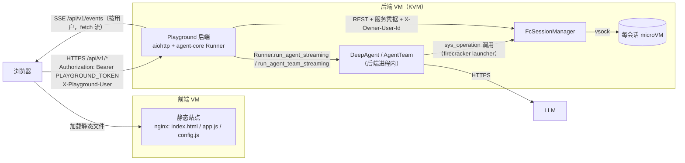

# Firecracker 会话沙箱 Playground 前端设计方案

英文版：[assets/design_en.md](assets/design_en.md)

## 1. 设计定位与阅读说明

本文设计一个 Playground：类似 ChatGPT 的网页前端，加一个运行 agent-core 的后端 API 服务。二者是两个独立部署单元，前端可放在一台 VM 上，后端与 Firecracker（FcSessionManager）放在另一台带 KVM 的 VM 上，用来以真实用户的方式使用和测试 Firecracker 会话沙箱的全部能力（多用户、多会话、DeepAgent / AgentTeam、生命周期、fork、workspace、密钥、MCP、出站、VM 任务与用户的消息、指标告警）。第 2–4 章说明目标与关键取舍，第 5 章给出接口与流程，第 8 章给出验收条件。实施结果将归档到 features。

## 2. 背景、目标与范围

### 2.1 背景与问题

- 已核实：第一至第五阶段与消息通道的能力只能通过 REST、Python 辅助函数和 e2e 测试使用（`deploy/firecracker/README.md`、S_01）。没有界面可以切换用户、同时打开多个会话、观察 VM 状态变化、回答 VM 任务的问题。
- 已核实：FcSessionManager 返回的 `base_url` / `cdp_url` 使用 Docker 网络 `fc-net` 内的主机名（`FCM_ADVERTISE_HOST=fc-manager`），浏览器无法直接访问；访问 manager 需要服务凭据 `FCM_API_TOKEN`，调用 LLM 需要 API key。二者都不能交给浏览器。
- 已核实：DeepAgent 以 `Runner.run_agent_streaming` 产出 `OutputSchema(type, index, payload)`；AgentTeam 以 `Runner.run_agent_team_streaming` 产出 `TeamOutputSchema`（多出 `source_member`、`role`），团队事件以 `payload.event_type = "team.*"` 标记（`agent_teams/schema/stream.py`）。

### 2.2 目标与关键场景

| 场景 / 触发条件 | 当前行为 | 目标行为 / 可观察变化 |
| --- | --- | --- |
| 切换用户（左下角用户菜单，选择或输入 alice、bob、noisy、fenced 等） | 不支持 | 侧栏只显示该用户的会话；之后所有操作以该用户身份执行，归属、级别、配额、白名单按该用户生效 |
| 新建会话（New chat，选择 DeepAgent 或 AgentTeam、可选 profile） | 只能调 REST | 新会话出现在侧栏，显示 VM 状态、级别、模板、出站模式 |
| 在会话中提问 | 只能写代码 | 回答以流式显示；AgentTeam 按成员显示输出；会话标题取首个问题 |
| 同时在多个会话中运行查询；一次把同一查询发给多个会话 | 不支持 | 每个会话各自运行，侧栏显示运行中标记；结果互不串扰 |
| 会话已暂停 / 已持久化 / manager 重启后，再次提问 | 只能调 REST | 提问自动唤醒或恢复 VM，界面显示状态变化与耗时，VM 中的文件与进程仍在 |
| VM 任务调用 `fc-notify` / `fc-ask` | 只能调 REST 读取 | 会话中出现通知与问题卡片，用户在卡片中回答，任务继续；其他会话或用户收到未读标记 |
| 会话面板操作：暂停、持久化、恢复、删除、fork、workspace 检查点 / 热替换、密钥、MCP、shell、文件、出站审计、debug | 只能调 REST | 每项在会话详情面板中可执行，并显示结果或错误（403 / 409 / 429 等） |
| 运维视图 | 只能 curl | 显示 `/metrics` 关键数值、告警、所有用户的会话汇总；可选重启 manager 以验证 persist-on-shutdown |

### 2.3 本次范围与非目标

- 本次包含：`deploy/firecracker/playground/backend/`（aiohttp + agent-core Runner 的 API 服务）与 `deploy/firecracker/playground/frontend/`（原生 HTML/CSS/JS 静态站点，无构建步骤），各自的 Docker 镜像与启动脚本、跨主机部署说明（访问令牌、CORS）、后端 API 测试与基于 Playwright 的界面 e2e 测试、README。
- 本次不包含：生产级登录与按用户权限（用户切换不鉴权；后端只用一个共享访问令牌防止被随意调用）；修改 agent-core 公共 API 或 FcSessionManager 契约；在界面中修改级别配置（仍由 manager 环境变量决定）；跨多台 Firecracker 主机（多个 manager）的调度。

### 2.4 术语与上下文

- **Playground 后端**：与 FcSessionManager 同机（同一 Docker 网络 `fc-net`）运行的 Python API 服务，持有 manager 凭据与 LLM 配置，代表当前选择的用户调用 agent-core 和 manager。对外只暴露 `/api/v1/*`。
- **Playground 前端**：纯静态文件（HTML/CSS/JS），可由任意静态服务器托管（提供 nginx 镜像）；运行时从 `config.js` 读取后端地址，与后端只通过 HTTP API 耦合。
- **会话类型**：`deepagent`（单个 DeepAgent）或 `team`（AgentTeam，leader + N 个预定义成员，共用一台 VM）。
- **运行（run）**：一次查询在后端对应的一个 asyncio 任务。

## 3. 设计约束、假设与待决问题

- 已确认约束与依赖：
  - 浏览器不得获得 `FCM_API_TOKEN` 或 LLM key；所有 manager / VM 访问经后端（D-01）。
  - 用户已选择：先设计后实现；Python 后端 + Web UI；自由切换用户、无登录（2026-11-27）。
  - 用户要求（2026-11-27）：前后端干净分离，前端可部署在一台 VM，后端与 Firecracker 部署在另一台 VM（D-08）。
  - 复用已有入口：`build_firecracker_gateway_config`、`get_session_info`、`fork_session`、`set_session_secrets`、`register_session_mcp_server`、`get_session_messages`、`reply_to_session_message`，以及 manager REST（S_01 §4.2）；不修改这些契约。
  - 每个用户注册一个 `SysOperation`，AgentTeam 成员共用同一 `SysOperationSpec` id（S_01 I-2、I-3）。
- 关键假设：
  - A-1：同一后端进程内，以相同 session id 再次调用 `Runner.run_agent_streaming` 会延续对话上下文（Runner 默认会话状态在进程内）。核实方式：e2e 中第二个问题引用第一个回答。不成立时：后端在提示中附上该会话最近的对话记录。
  - A-2：后端重启后，DeepAgent 对话上下文不保证恢复，但 VM 与其中文件保留；界面中的对话记录由后端 SQLite 保留。
  - A-3：`OutputSchema.type` 的取值随 harness 版本变化；前端只对 `answer`、`llm_output`、`llm_reasoning`、工具调用类等已知类型做专门展示，其余以通用折叠块展示。
- 待决问题：
  - Q-1（已决，2026-11-27）：AgentTeam 默认 3 个通用成员，新建时可选 1–5。
  - Q-2（已决，2026-11-27）：提供“重启 manager”按钮，默认关闭，由 `PLAYGROUND_DOCKER=1` 开启。

## 4. 总体方案与设计取舍

### 4.1 方案概览



箭头表示调用方向。浏览器从前端 VM 加载静态文件，然后直接跨域调用后端 VM 上的 `/api/v1`（前端 VM 不转发 API，也不持有任何凭据）。浏览器只与后端 API 通信；后端以当前用户身份运行智能体、调用 manager，并把智能体输出、运行状态、VM 消息和会话状态通过每个用户一条的 SSE 推给浏览器。

### 4.2 关键决策

#### D-01 后端代理一切访问（BFF）

- 选择与依据：浏览器只访问 `/api/*`；后端持有 manager 凭据与 LLM key，按请求头 `X-Playground-User` 选定用户并以 `X-Owner-User-Id` 调用 manager。依据：凭据不能下发；`fc-manager` 主机名只在 `fc-net` 内可解析。
- 代价与成立条件：用户切换不鉴权；后端以共享访问令牌 `PLAYGROUND_TOKEN` 防止被网络上的其他人调用（见 D-08）。
- 实现体现：§5.3 接口、§5.11 安全。

#### D-02 每用户一条 SSE 推送

- 选择与依据：`GET /api/events` 推送 `session.updated`、`run.*`、`vm.message`、`alert` 事件；比按会话建连接更适合“多会话并行 + 未读标记”。
- 代价：事件带 `session_id`，前端自行分发；断线后按 `last_event_id` 补发（后端保留每用户最近 1000 条事件）。浏览器原生 `EventSource` 不能带 `Authorization` 头，前端用 `fetch` 读取 `text/event-stream` 流并自行解析与重连。
- 相关候选：R-02。

#### D-03 每会话一个运行任务，跨会话并行

- 选择与依据：每次查询成为一个 asyncio 任务；同一会话同时只允许一个运行（新查询返回 409，前端提示“运行中”或可取消）；不同会话、不同用户的运行并行，受 `PLAYGROUND_MAX_RUNS`（默认 8）全局上限约束。“批量查询”把同一问题发给所选的多个会话，各自成为独立运行。
- 代价：同一会话的排队由用户处理，不做服务端排队。

#### D-04 会话类型与智能体构造

- `deepagent`：与 `examples/firecracker/deep_agent_firecracker.py` 相同的构造方式（每用户 `fc-<user>` SysOperation、`build_model()`），系统提示加入工作目录说明与 `fc-notify` / `fc-ask` 用法。
- `team`：与 phase 3 e2e 相同的 `TeamAgentSpec`（leader + N 个预定义成员、in-process 传输、SQLite 存储于后端数据目录、共享 `SysOperationSpec` id `fc-team-<user>`）；按成员显示输出，团队完成（`team.completed` / `team.idle`）即运行结束。
- 会话类型在创建时确定，记录在后端 SQLite。

#### D-05 事实归属

- VM 状态、级别、快照等以 manager 为准（每次列表 / 详情实时查询并缓存 2 秒）；会话标题、类型、对话记录、运行状态以后端 SQLite / 内存为准。后端在会话操作后推送 `session.updated`。

#### D-06 前端用原生 HTML/CSS/JS，布局仿 ChatGPT

- 左侧栏：New chat、批量查询、运维视图入口、会话列表（状态点、运行中转圈、未读消息数）、底部用户菜单（切换 / 新建用户名）。
- 主区：对话流（用户消息、智能体流式输出、团队成员标签、工具调用折叠块、VM 消息卡片），底部输入框（Enter 发送、Shift+Enter 换行、运行中显示停止按钮）。
- 右侧可折叠“会话详情”面板：VM 信息与操作（§2.2 列出的全部操作）。
- 无构建步骤，由前端自己的静态服务器提供（见 D-08）；首次打开显示设置对话框（后端地址可覆盖 `config.js` 默认值、访问令牌）；支持浅色 / 深色。

#### D-07 可选的 manager 重启

- `PLAYGROUND_DOCKER=1` 时挂载 Docker socket，运维视图提供“重启 manager”，用于验证 persist-on-shutdown 与重启后唤醒。默认关闭。

#### D-08 前后端为两个独立部署单元

- 选择与依据：用户要求前端与后端分别部署在不同 VM。目录、镜像、配置完全分开，二者之间唯一的耦合是版本化的 HTTP 契约 `/api/v1`（§5.3）：
  - 前端：`playground/frontend/` 只有静态文件与 `config.js`（`window.PLAYGROUND_CONFIG = {apiBaseUrl: "https://backend-host:8800"}`，容器启动时由环境变量 `PLAYGROUND_API_BASE_URL` 生成）；不含任何 Python、凭据或对 Firecracker 的知识。提供基于 nginx 的镜像，也可直接用任意静态托管。
  - 后端：`playground/backend/` 是 Python 包，只提供 `/api/v1/*` 与 `/healthz`，不再提供页面（开发时可用 `PLAYGROUND_SERVE_FRONTEND=<dir>` 选项同源托管以便调试，默认关闭）。
- 跨主机访问控制：
  - `PLAYGROUND_TOKEN`（必填）：前端首次打开时在设置中输入，保存在浏览器 `localStorage`，每个请求带 `Authorization: Bearer`；后端以常量时间比较。
  - `PLAYGROUND_ALLOWED_ORIGINS`：CORS 白名单（如 `https://frontend-host`）；预检请求允许 `Authorization`、`X-Playground-User`、`Content-Type`、`Last-Event-ID`。
  - `PLAYGROUND_BIND`（默认 `0.0.0.0:8800`）；建议在后端 VM 前加 TLS 反向代理，或只在内网使用。
- 后端到 manager 也通过 URL（`FC_MANAGER_URL`）访问，因此后端 API 与 manager 将来也可以拆到不同主机（manager 需对后端可达）。
- 代价：多一个令牌与 CORS 配置；SSE 需要自行实现 fetch 流解析。
- 相关候选：R-05。

### 4.3 替代方案与排除理由

| 候选 / 关联决策 | 候选目的与关键差异 | 拒绝或暂缓原因 | 重新评估条件 |
| --- | --- | --- | --- |
| R-01 / D-01 浏览器直连 manager | 少一层后端 | 需把服务凭据交给浏览器；`fc-manager` 主机名浏览器不可解析；智能体仍需在 Python 中运行 | manager 提供面向终端用户的鉴权时 |
| R-02 / D-02 WebSocket | 双向通道 | 上行操作用 REST 已足够；SSE 自带重连，实现更简单 | 需要低延迟双向交互（如终端）时 |
| R-03 / D-06 React + Vite | 组件化 | 用户选择无构建步骤的 Python 后端 + Web UI | UI 规模显著扩大时 |
| R-04 在 agent-core 中新增通用 HTTP 服务 API | 可复用 | 超出本次测试工具的范围，且会形成新的公共契约 | 产品需要官方服务端时 |
| R-05 / D-08 前端 VM 上用反向代理转发 `/api` 到后端（同源） | 无需 CORS，令牌可放在代理中 | 令牌放在代理里等于任何能打开前端的人都能调用后端；同源方案把两台 VM 耦合在一起。保留为部署选项（README 给出 nginx 示例），不作为默认 | 需要对浏览器隐藏后端地址时 |

## 5. 详细设计

### 5.1 模块责任与关键不变量

| 组件 | 责任 |
| --- | --- |
| `backend/fc_playground/server.py` | aiohttp 应用、`/api/v1/*` 路由、令牌与 CORS 中间件、SSE |
| `backend/fc_playground/runs.py` | 运行任务：构造 DeepAgent / TeamAgentSpec、消费流、规整为事件、取消 |
| `backend/fc_playground/vm.py` | manager 访问（复用 launcher 辅助函数与 REST）、去 token、每会话消息跟随器 |
| `backend/fc_playground/store.py` | SQLite：会话元数据、对话记录 |
| `backend/fc_playground/events.py` | 每用户事件中心与补发缓冲 |
| `frontend/` | `index.html`、`app.js`（含 API 客户端与 fetch-SSE）、`style.css`、`config.js` 模板、nginx 配置 |

关键保证：

- P-1：浏览器收到的任何响应与事件中不出现 manager 凭据、LLM key、guest token（`base_url` 等含 token 的 URL 在后端剥离）。
- P-2：每个 `/api` 请求只能读写 `X-Playground-User` 所属的会话；越权的操作由 manager 返回 403 并原样提示，不在后端绕过。
- P-3：同一会话同时至多一个运行；运行结束（成功、失败、取消）都会发送 `run.finished`。
- P-4：VM 消息只推送给会话所属用户的事件流。
- P-5：没有正确 `PLAYGROUND_TOKEN` 的请求一律 401（`/healthz` 除外）；不在白名单中的来源得不到 CORS 许可。
- P-6：前端不包含任何后端实现细节以外的耦合：更换后端地址只需修改 `config.js` / `PLAYGROUND_API_BASE_URL`。

### 5.2 关键类与函数设计

| 类 / 函数 | 变更类型 | 职责 |
| --- | --- | --- |
| `server.build_app(settings) -> web.Application` | 新增，内部 | 路由、中间件（用户名校验、错误转 JSON、去除 token） |
| `runs.RunManager` | 新增，内部 | `start(user, session_id, text) -> run_id`、`cancel(session_id)`、`is_running(session_id)`；持有任务表与全局信号量 |
| `runs.normalize_chunk(chunk) -> list[dict]` | 新增，内部 | 把 `OutputSchema` / `TeamOutputSchema` 规整为 `{member, kind, text, data}` |
| `vm.MessageFollower` | 新增，内部 | 用户有事件流时，对其每个 RUNNING 会话循环调用 `get_session_messages(after, wait_seconds=25)`，新消息推送 `vm.message` |
| `store.PlaygroundStore` | 新增，内部 | `sessions`、`transcript` 两张表与事件环形缓冲 |
| `events.EventHub` | 新增，内部 | 每用户订阅者列表、事件序号、`last_event_id` 补发 |

### 5.3 接口定义（后端 `/api/v1`，均需 `Authorization: Bearer <PLAYGROUND_TOKEN>` 与 `X-Playground-User`，用户名匹配 `[A-Za-z0-9_.@-]{1,64}`；下表省略 `/api/v1` 前缀中的版本号写作 `/api/...`）

| 入口 | 输入与成功结果 | 失败语义 |
| --- | --- | --- |
| `GET /api/me` | 当前用户、级别（由会话描述得出）、已知用户列表 | — |
| `GET /api/sessions` | 当前用户会话：后端元数据 + manager 描述（去 token） | manager 不可用时只返回元数据并标记 `vm_unknown` |
| `POST /api/sessions` `{kind, title?, profile?, team_size?}` | 新会话（立即创建 VM）；201 | 400 / 429（配额）/ 503 透传 |
| `GET /api/sessions/{id}` | 详情：元数据、VM 描述、运行状态、对话记录 | 404 / 403 |
| `DELETE /api/sessions/{id}` | 删除 VM 与记录（取消运行中任务） | 403 |
| `POST /api/sessions/{id}/query` `{text}` | 202 `{run_id}`；输出经 SSE | 409 运行中；429 超过全局并发 |
| `POST /api/batch-query` `{session_ids, text}` | 202 `{runs:[{session_id, run_id | error}]}` | 每项单独报错 |
| `POST /api/sessions/{id}/cancel` | 取消运行 | 404 无运行 |
| `POST /api/sessions/{id}/vm/{action}` | `pause` / `persist` / `resume`（可带 `checkpoint_ref`） | 409 等透传 |
| `POST /api/sessions/{id}/fork` `{count}` | 新会话（继承类型与标题后缀“fork n”） | 透传 |
| `GET|POST /api/sessions/{id}/workspace` | 检查点列表 / `{"checkpoint": name}` 创建 / `{"swap": name}` 热替换 | 透传 |
| `PUT /api/sessions/{id}/secrets` `{KEY: value | null}` | 返回键名 | 透传 |
| `POST /api/sessions/{id}/mcp` `{name, command, args, env}` | 注册到该会话 | 透传 |
| `POST /api/sessions/{id}/shell` `{command}` | `{exit_code, stdout, stderr}`（直接在 VM 中执行） | 透传 |
| `GET /api/sessions/{id}/files?path=` | 目录列表或文件内容（文本 ≤ 256 KiB） | 透传 |
| `GET /api/sessions/{id}/messages` / `POST .../messages/{mid}/reply` `{text}` | VM 消息与回答 | 404 / 409 透传 |
| `GET /api/sessions/{id}/egress` / `GET /api/sessions/{id}/debug` | 出站审计 / debug（去 token） | 透传 |
| `GET /api/ops` | 指标摘要、告警、按用户汇总的会话（读取 manager `/metrics`、`/v1/alerts`，汇总后端已知用户） | — |
| `POST /api/ops/restart-manager` | 仅 `PLAYGROUND_DOCKER=1` | 404 未启用 |
| `GET /api/events?last_event_id=` | SSE（`text/event-stream`；前端以 fetch 读取） | 401 |
| `GET /healthz` | `{"status": "ok", "api_version": 1}`（无需令牌，供部署检查） | — |

事件（SSE `data:` 为 JSON，均带 `id`、`type`、`session_id`）：

| type | 字段 | 说明 |
| --- | --- | --- |
| `session.updated` | `session` | 状态、标题、运行标记变化 |
| `run.started` | `run_id`, `text` | 用户消息已记录 |
| `run.chunk` | `run_id`, `member`, `kind`, `text`, `data` | 流式输出（`kind`: `answer` / `delta` / `reasoning` / `tool_call` / `tool_result` / `team_event` / `other`） |
| `run.finished` | `run_id`, `status`（`ok` / `error` / `cancelled`）, `error?`, `duration_s` | 运行结束 |
| `vm.message` | `message` | VM 任务的通知或问题（含状态变化） |
| `alert` | `alerts` | 运维告警变化 |

### 5.5 数据模型与事实归属

| 数据 | 权威位置 | 生命周期 |
| --- | --- | --- |
| VM 状态、级别、模板、快照 | FcSessionManager | 实时读取 |
| 会话元数据（id、owner、kind、title、team_size、created） | 后端 SQLite `sessions` | 创建写入；删除移除 |
| 对话记录（role、member、kind、text、ts） | 后端 SQLite `transcript` | 运行中追加（delta 合并后落库） |
| 运行状态 | 后端内存 | 运行期间 |
| 事件补发缓冲 | 后端内存（每用户 1000 条） | 进程生命周期 |

### 5.7 正常执行流程（提问）

1. 前端 `POST /api/sessions/{id}/query`；后端校验归属（manager `GET` 会话）、检查运行中与并发上限，写入用户消息，发 `run.started`。
2. 后端任务在该会话 id 下调用 `Runner.run_agent_streaming`（或团队流）；智能体的第一次 sys_operation 调用经 launcher `POST /v1/sessions`，manager 视需要唤醒 / 恢复 VM。后端同时发 `session.updated`（状态 RUNNING）。
3. 每个输出块经 `normalize_chunk` 转为 `run.chunk`，写入对话记录。
4. 流结束（团队以 `team.completed` / `team.idle` 为准）发 `run.finished`。

VM 消息：用户有事件流时，`MessageFollower` 对其 RUNNING 会话长轮询；新消息发 `vm.message`。回答经 `reply_to_session_message`，manager 唤醒 VM。

### 5.8 异常、中断与重试处理

- manager 错误（400 / 403 / 404 / 409 / 429 / 503）原样转为 `{error, status}`，前端以提示条显示。
- 运行中 LLM 或工具错误：`run.finished` `status=error`，错误文本写入对话记录。
- 取消：`task.cancel()`；`run.finished` `status=cancelled`；VM 中已启动的后台任务不受影响。
- 后端重启：运行中任务丢失，会话元数据与对话记录保留，下次提问正常运行（A-2）。
- SSE 断线：浏览器自动重连并携带 `Last-Event-ID`，后端补发缓冲内事件。

### 5.9 并发与一致性

- 每会话一个 `asyncio.Lock` 判定运行中；全局 `asyncio.Semaphore(PLAYGROUND_MAX_RUNS)`。
- 同一用户在多个浏览器标签打开时，各自订阅同一事件流，状态一致。
- 不同用户之间不共享 SysOperation 与 VM（沿用 S_01 I-2）。

### 5.11 专项设计

- 安全：后端以 `PLAYGROUND_TOKEN` 鉴权、以 `PLAYGROUND_ALLOWED_ORIGINS` 限制跨域来源；用户切换本身不鉴权，令牌持有者可以以任意用户名操作，因此只适合测试环境；跨主机时应通过 TLS（反向代理）访问；响应中剥离 `base_url`、`cdp_url`、`mcp_url` 中的 token；前端渲染文本一律转义（Markdown 仅支持代码块与换行，使用自写的安全渲染）。
- 资源与文件布局：

```text
deploy/firecracker/playground/
  backend/                         # 部署到后端 VM（与 FcSessionManager 同机）
    fc_playground/  __init__.py  __main__.py  server.py  runs.py  vm.py  store.py  events.py
    Dockerfile                     # agent-core 依赖 + fc_playground；不含前端文件
    run_backend.sh                 # 在 fc-net 上启动，发布 8800 端口
  frontend/                        # 部署到前端 VM（任意静态托管）
    index.html  app.js  style.css  config.template.js
    nginx.conf  Dockerfile         # nginx:alpine；启动时由 PLAYGROUND_API_BASE_URL 生成 config.js
    run_frontend.sh                # 发布 8080 端口
```

部署示例：前端 VM `PLAYGROUND_API_BASE_URL=https://backend.example:8800 run_frontend.sh`；后端 VM `PLAYGROUND_TOKEN=... PLAYGROUND_ALLOWED_ORIGINS=https://frontend.example run_backend.sh`（同机已运行 FcSessionManager）。本机测试时二者也可在同一台机器上以不同端口运行，仍按跨源方式通信。

## 6. 影响面与实施设计

| 实施项 | 文件 | 内容 | 验证 |
| --- | --- | --- | --- |
| I-01 | `backend/fc_playground/store.py`、`events.py` | SQLite 与事件中心 | V-01 |
| I-02 | `backend/fc_playground/vm.py` | manager 访问、去 token、消息跟随 | V-05、V-07 |
| I-03 | `backend/fc_playground/runs.py` | DeepAgent / 团队运行与事件规整 | V-02、V-03、V-04 |
| I-04 | `backend/fc_playground/server.py`、`__main__.py` | 路由、令牌与 CORS、SSE | 全部 |
| I-05 | `frontend/*` | 单页 UI、API 客户端、fetch-SSE、设置（后端地址 / 令牌） | V-09 |
| I-06 | `backend/Dockerfile`、`run_backend.sh`、`frontend/Dockerfile`、`nginx.conf`、`run_frontend.sh` | 两个独立镜像与启动脚本 | V-01、V-11 |
| I-07 | `tests/system_tests/extensions/sys_operation/sandbox/test_firecracker_playground_e2e.py` | API 与界面 e2e | 全部 |
| I-08 | `deploy/firecracker/README.md`、feature 记录 | 文档 | — |

核对结论：不修改 `openjiuwen/` 下任何代码与公共 API，不修改 manager 契约；对已有会话、数据无兼容影响。

### 6.2 文档同步

- spec：无契约变化（Playground 不属于 S_01 的公共契约）；在 S_01 的“关联 feature”中链接新记录。
- 其他入口：README 增加 “Playground” 一节（启动、用户切换、功能导览）。

## 8. 验证设计与通过条件

| 验证 ID | 场景 | 操作 | 预期结果 / 通过条件 | 层级 |
| --- | --- | --- | --- | --- |
| PG-V-01 | 启动 | 分别启动后端与前端容器；访问前端 `/` 与后端 `/healthz`、`/api/v1/me` | 页面加载并显示后端连接正常；响应中无 manager 凭据、LLM key、guest token | 真实联调 |
| PG-V-02 | DeepAgent 提问与续问 | alice 新建会话，提问后再引用上一回答续问 | SSE 依次收到 `run.started`、若干 `run.chunk`、`run.finished ok`；VM 中出现智能体写的文件；续问体现上下文（A-1） | 真实 LLM |
| PG-V-03 | 多会话并行与批量查询 | alice 两个会话、bob 一个会话同时运行；再对 3 个会话批量查询 | 各会话事件只带自身 session_id，均完成；同会话重复提问 409 | 真实 LLM |
| PG-V-04 | AgentTeam | 新建 team 会话提问 | 输出带成员名；只有一台 VM；运行结束 | 真实 LLM |
| PG-V-05 | 唤醒与重启 | 暂停 / 持久化后提问；（`PLAYGROUND_DOCKER=1`）重启 manager 后提问 | 提问成功；VM 中文件仍在；状态在 `session.updated` 中可见 | 真实联调 |
| PG-V-06 | 用户隔离 | bob 访问 alice 的会话各接口 | 403 / 404，alice 的数据不变；bob 的事件流收不到 alice 的事件 | 真实联调 |
| PG-V-07 | VM 任务消息 | 通过 shell 或智能体启动 `fc-ask` 任务 | 事件流收到 `vm.message`，回答后任务完成，文件内容正确 | 真实联调 + LLM |
| PG-V-08 | 会话面板操作 | fork、workspace 检查点 / 热替换、密钥、MCP、文件、出站、debug | 各操作成功并反映在界面数据；限额用户（noisy）超配额得到 429 | 真实联调 |
| PG-V-09 | 界面 | Playwright 打开页面：切换用户、新建会话、发送查询、回答 VM 问题 | 页面元素按预期出现；无控制台错误 | 浏览器 e2e |
| PG-V-10 | 取消与错误 | 运行中取消；manager 返回错误 | `run.finished cancelled`；错误提示，后端不崩溃 | 真实联调 |
| PG-V-11 | 前后端分离与访问控制 | 前端与后端运行在不同容器、不同来源（不同主机名 / 端口）；无令牌、错误令牌、非白名单来源分别访问 | 跨源调用全部功能正常；无令牌 / 错误令牌 401；非白名单来源的预检得不到 `Access-Control-Allow-Origin`；前端镜像中不含 Python 与凭据 | 真实联调 + 浏览器 e2e |

## 9. 设计风险与已知限制

### 9.1 设计风险

| 风险 | 影响 | 应对 | 核实 |
| --- | --- | --- | --- |
| `OutputSchema.type` 取值与假设不同 | 输出展示不理想 | 通用展示兜底（A-3） | PG-V-02 观察实际类型 |
| Runner 对同一 session 的上下文延续不成立（A-1） | 续问丢上下文 | 提示中附带最近对话 | PG-V-02 |
| 主机资源（约 7 GB 内存）不足以同时运行很多 VM | 并行测试受限 | `PLAYGROUND_MAX_RUNS` 与 warm pool 大小可调 | PG-V-03 |

### 9.2 已知设计限制

- 用户切换不鉴权；共享令牌只区分“能否调用后端”，不区分用户，仅适合测试环境。
- 后端重启后 DeepAgent 对话上下文不恢复（对话记录可见）。
- 界面不提供级别配置编辑。

## 10. 按日期记录的评审与设计修订

| 日期 | 评审人 / 确认方 | 主题 | 结论 | 修改与依据 |
| --- | --- | --- | --- | --- |
| 2026-11-27 | alexbhyeo（用户） | 流程与技术选型 | 先设计后实现；Python 后端 + Web UI；自由切换用户、无登录 | 用户在会话中的选择 |
| 2026-11-27 | alexbhyeo（用户） | 设计评审 | 批准；Q-1、Q-2 采用建议方案 | 用户回复“use the recommendation for question 1 and 2. proceed to implement” |
| 2026-11-27 | alexbhyeo（用户） | 部署形态 | 前后端干净分离：前端一台 VM，后端与 Firecracker 另一台 VM | 新增 D-08、R-05、P-5、P-6、PG-V-11，修改 §1、§2.3、§4.1、§5.1、§5.3、§5.11、§6 |

## 11. 参考与交接

- 关联设计与 spec：D-20261124-0855-firecracker-session-manager；S_01_firecracker-session-sandbox。
- 开发交接：设计已批准（2026-11-27），Q-1、Q-2 已决；按 §6 实施项与 §8 验收场景进入 jw-dev。
- 关联实施归档：尚无。
