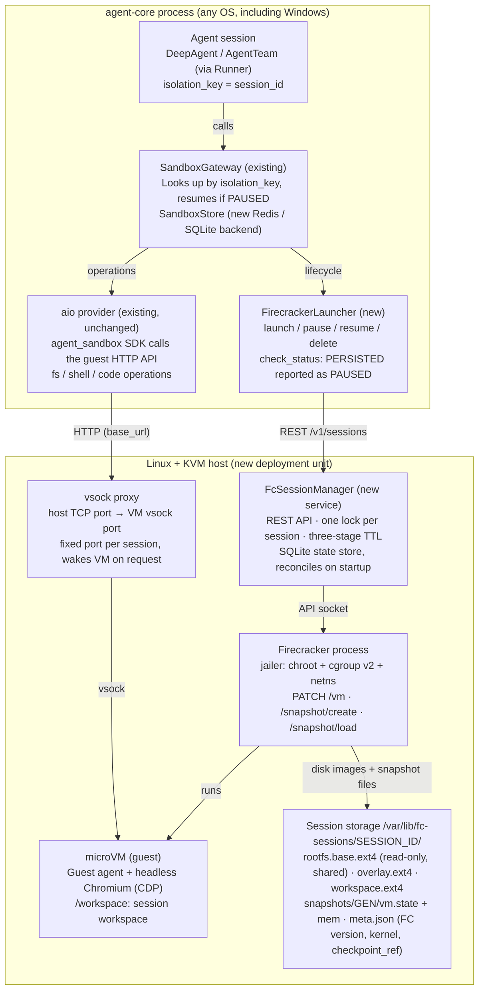
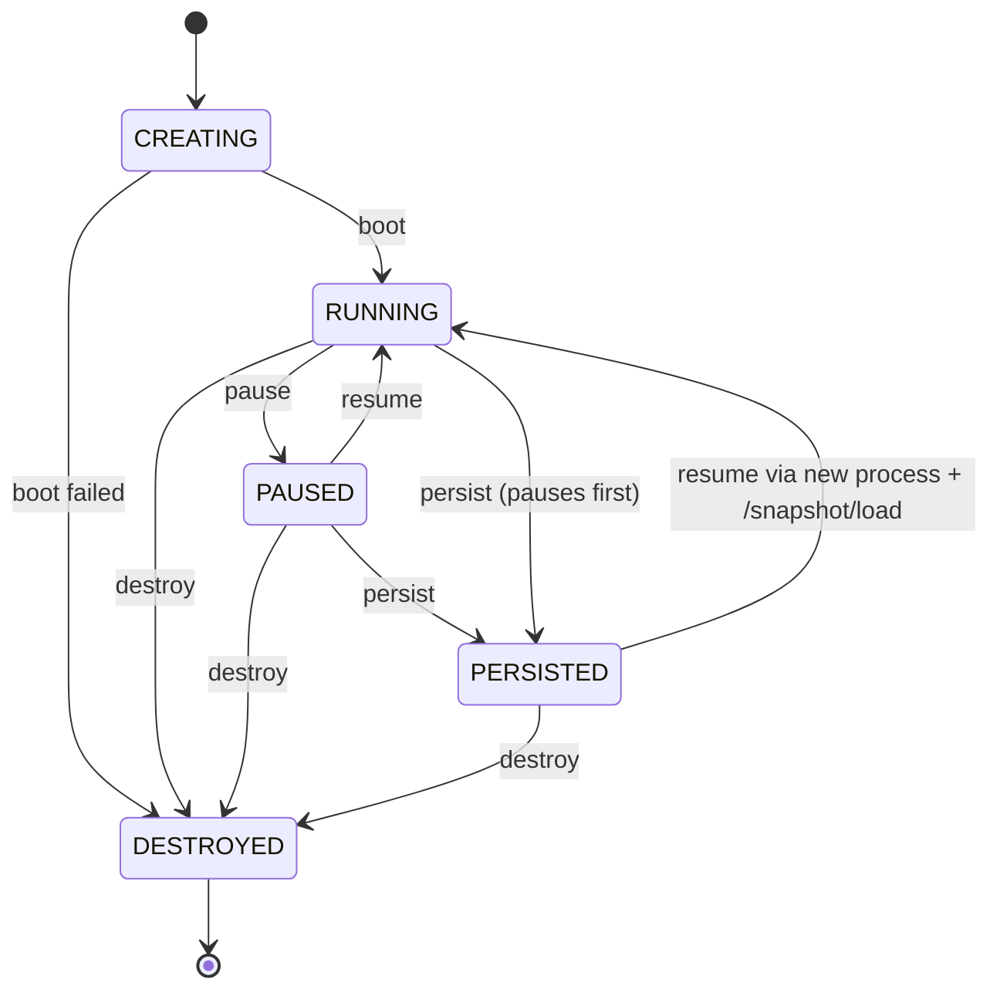

# Firecracker Session Manager Design Proposal

Canonical version (Chinese): [../design.md](../design.md). Design ID: D-20261124-0855-firecracker-session-manager.

## Background and goals

We propose adding a `firecracker` sandbox launcher, backed by an FcSessionManager service on a Linux/KVM host. Each DeepAgent or AgentTeam session then gets its own microVM, which agent-core can create, pause, persist, resume and destroy.

Today the agent-core sandbox relies on externally pre-deployed services (`pre_deploy` + aio / jiuwenbox / yuanrong). After a session ends, the execution environment (files, processes, installed dependencies) is up to the external system. agent-core cannot guarantee it comes back together with the session state held in the checkpointer.

**Goals**

1. Isolation: one microVM per session, with KVM hardware isolation, stronger than containers.
2. Lifecycle: agent-core drives all five operations — create / pause / persist / resume / destroy.
3. Recoverability: a persisted session can be restored as it was, including in-memory processes, after a process restart or days later.
4. Low intrusion: reuse the existing `SandboxLauncher`, `SandboxGateway` and provider abstractions. DeepAgent / AgentTeam code does not change.

**Non-goals**: multi-host scheduling, moving snapshots between hosts, GPU passthrough. These are left to later work.

## Current state (agent-core `staging` branch)

The lifecycle interface already exists. What is missing is a launcher that actually manages VMs, a persistent store, and the teardown path when a session is released.

| Component | Location | Today | What it means here |
| --- | --- | --- | --- |
| `SandboxLauncher` | `core/sys_operation/sandbox/launchers/base.py` | Defines `launch / pause / resume / delete / check_status` | Implement a `FirecrackerLauncher` directly |
| `SandboxRegistry` | `core/sys_operation/sandbox/sandbox_registry.py` | Registers launchers and providers via decorators | Register `launcher_type="firecracker"` |
| `SandboxGateway` | `core/sys_operation/sandbox/gateway/gateway.py` | Looks up the record by `isolation_key`: resumes if PAUSED, launches if missing; supports `on_stop` and `idle_ttl_seconds` | Already a per-session routing layer; only the "persisted" state is missing |
| `InMemorySandboxStore` | `gateway/sandbox_store.py` | In-memory only; `GatewayStoreConfig.redis_url` is reserved but unimplemented | Records are lost on process restart; a persistent store is required |
| `ContainerScope` | `core/sys_operation/config.py` | `SYSTEM / SESSION / CUSTOM`, default SESSION; the `{session_id}` template is resolved at call time | One-VM-per-session mapping is ready |
| aio provider | `extensions/sys_operation/sandbox/providers/aio.py` | Calls an HTTP API through the `agent_sandbox` SDK for fs / shell / code | Run an AIO-compatible service in the guest and the provider is reused unchanged |
| `Runner.release(session_id)` | `core/runner/runner.py:484` | Cleans up the checkpointer and team tables; **does not call** `SandboxGateway.release_sandbox` | The VM is not reclaimed when a session is released; this must be wired up |
| `NativeHarness.dispose` | `agent_teams/harness/native_harness.py:593` | Only removes the sys_operation from `resource_mgr` | Same gap: the sandbox is not released when a team member is torn down |
| Checkpointer | `core/session/checkpointer/` | Saves agent / workflow state by `session_id` (in-memory, persistence, redis) | VM snapshots must be paired with checkpoints so both sides stay consistent |

## Firecracker capabilities and constraints

All five lifecycle operations map onto native Firecracker APIs. This is based on the local clone `D:\git_projects\firecracker` (upstream [firecracker-microvm/firecracker](https://github.com/firecracker-microvm/firecracker), commit `4e65d4309`): `docs/snapshotting/snapshot-support.md`, `docs/jailer.md` and `docs/vsock.md`.

| Session operation | Firecracker API | Notes |
| --- | --- | --- |
| create | `PUT /boot-source`, `/drives`, `/network-interfaces`, `/vsock`, `/actions InstanceStart` | Launched through the jailer: own uid/gid, chroot, cgroup v2, netns |
| pause | `PATCH /vm {"state":"Paused"}` | vCPUs and device emulation stop; memory stays resident; fastest to resume |
| persist | pause → `PUT /snapshot/create {"snapshot_type":"Full"}` → exit the process | Produces a vmstate file and a memory file; disk files are ours to manage and are already fsync'd |
| resume | From PAUSED: `PATCH /vm {"state":"Resumed"}`; from PERSISTED: new process, `PUT /snapshot/load {"resume_vm":true}` | Load maps memory MAP_PRIVATE and faults it in on demand; `network_overrides` and `vsock_override` rebind host resources |
| destroy | `SendCtrlAltDel` or kill, then clean up chroot, TAP, disks and snapshots | Idempotent |

**Constraints we must respect**

- The host must be Linux + KVM. A Windows dev machine cannot run it directly, so FcSessionManager runs as a separate service on a Linux host and agent-core calls it over HTTP.
- A snapshot only restores on a host with identical software and hardware configuration, and the format is tied to the Firecracker version. Snapshot metadata must record the Firecracker version, host kernel and CPU template.
- After a restore, every open vsock connection is closed (listen sockets survive), and TCP connections are not guaranteed to survive either. Host-guest traffic must use short-lived connections that can reconnect.
- Restoring the same snapshot more than once is unsafe: RNG seeds, the entropy pool and tokens get duplicated. A session snapshot is restored only once; cloning for a warm pool or fork requires VMGenID and reseeding in the guest.
- Diff snapshots are still in developer preview. Phases 1–3 use Full snapshots only; phase 4 introduces Diff snapshots.
- MMDS data and logger / metrics configuration are not saved in the snapshot and must be re-applied after a restore.

## Architecture



agent-core only routes requests and issues lifecycle calls. FcSessionManager on the Linux host owns the VMs, snapshots and disks. fs / shell / code operations bypass FcSessionManager: the aio provider reaches the guest directly through the vsock proxy.

**Network boundary**: the frontend talks only to agent-core, and only agent-core reaches the guest, through the vsock proxy; the guest exposes no inbound ports. agent-core's only outbound internet access is the LLM endpoint (egress allowlist). The guest can reach the public internet (`pip install`, `git clone`, and so on): each VM's TAP device sits in its own jailer netns and goes out through host NAT. Outbound traffic may only go to public addresses; the host, private ranges and cloud metadata addresses are blocked. MMDS requests are intercepted by Firecracker at the device layer and never reach the TAP, so these rules do not affect them.

**Deployment**: FcSessionManager, the vsock proxy and the Firecracker processes all run in one Ubuntu-based Docker container. Requirements:

- The machine running Docker must itself be Linux with KVM (bare metal, or a cloud VM with nested virtualization). The container does not provide KVM; Docker Desktop on Windows or macOS usually cannot expose `/dev/kvm`, so dev machines run only agent-core.
- The container runs `--privileged` with `/dev/kvm` passed in, because the jailer creates cgroups, network namespaces, TAP devices and NAT rules. Firecracker's own `tools/devtool` runs its test container the same way.
- `/var/lib/fc-sessions` and the SQLite state store must live on a host volume. VMs are child processes of the container, so restarting the container kills every RUNNING or PAUSED VM; only PERSISTED sessions survive a restart, and reconciliation marks the rest as faulted.

## Session lifecycle



Resources held per state: RUNNING holds vCPUs + memory; PAUSED stops vCPUs but keeps memory resident; PERSISTED has no process and holds only disk; DESTROYED has deleted the VM process, disks, snapshots and TAP.

Resuming from PAUSED only reschedules the vCPUs. Resuming from PERSISTED starts a new process and loads the snapshot, faulting memory in on demand. RUNNING can also be persisted directly; the manager pauses first, then snapshots.

| Transition | Triggered by | Firecracker calls and host actions |
| --- | --- | --- |
| → CREATING → RUNNING | Gateway resolves an `isolation_key` for the first time | Create overlay and workspace disks → start via jailer → configure devices → `InstanceStart` → wait for the guest service |
| RUNNING → PAUSED | `on_stop="pause"` with `pause_mode="memory"`; or idle longer than T1 | `PATCH /vm Paused` |
| PAUSED → RUNNING | Next tool call (Gateway sees PAUSED) | `PATCH /vm Resumed` |
| RUNNING / PAUSED → PERSISTED | `pause_mode="snapshot"`; or paused longer than T2; or host memory pressure | flush checkpoint → `PATCH /vm Paused` → `PUT /snapshot/create Full` → write meta.json → exit process, delete TAP |
| PERSISTED → RUNNING | Next tool call (via `launch()` or proxy wake-up) or explicit `:resume` | Check version and `checkpoint_ref` → new jailer → `PUT /snapshot/load {resume_vm:true}` with `network_overrides` / `vsock_override` → re-apply MMDS and logger config |
| any → DESTROYED | `Runner.release`, team dispose, `on_stop="delete"`, persisted longer than T3, boot failure | Kill process → delete chroot, TAP, disks, snapshots and the record |

### Default policy

| Setting | Default | Why |
| --- | --- | --- |
| `on_stop` (when a run ends) | `keep` | agent-core does not pause the VM when a run ends; FcSessionManager owns the timing, so a quick follow-up finds the VM still running and background jobs keep going |
| `pause_mode` (when a caller pauses explicitly) | `memory` | Resuming from memory takes milliseconds |
| T1: RUNNING → PAUSED | 10 min with no tool call reaching the proxy | Tool calls in a run come seconds to minutes apart, so an active run is in practice never paused. Pausing freezes background jobs (dev server, build, pip install); they continue after resume but make no progress while paused |
| T2: PAUSED → PERSISTED | 30 min; earlier under host memory pressure, least recently used first | A paused VM still holds all its memory: at 2 GiB each, a 64 GiB host fits roughly 25–30 |
| T3: PERSISTED → DESTROYED | 7 days, never shorter than the checkpointer's retention | If the VM is deleted before the checkpoint, the agent remembers files that no longer exist |
| Gateway `idle_ttl_seconds` | unset | It always deletes; FcSessionManager owns all three timeouts |

All of these are per-profile settings. If phase 2 measures a snapshot restore of a 2 GiB guest at under about 1 second, T2 can drop to about 10 minutes.

## API design and integration points

Two layers: FcSessionManager exposes a REST API, and `FirecrackerLauncher` in agent-core is a thin client for it.

### FcSessionManager REST API

| Method | Path | Purpose | Idempotent |
| --- | --- | --- | --- |
| POST | `/v1/sessions` | Create a session from `session_id` and `profile` (vCPUs, memory, image, disk size, network policy); if it exists and is PERSISTED, restore it | Yes |
| GET | `/v1/sessions/{id}` | Return `state`, `base_url`, `snapshot_gen`, `last_used_ts` | Yes |
| POST | `/v1/sessions/{id}:pause` | RUNNING → PAUSED | Yes |
| POST | `/v1/sessions/{id}:persist` | RUNNING/PAUSED → PERSISTED; accepts a `checkpoint_ref` to record the matching checkpoint | Yes |
| POST | `/v1/sessions/{id}:resume` | PAUSED/PERSISTED → RUNNING | Yes |
| POST | `/v1/sessions/{id}:fork` | Load N independent VMs from the session's latest snapshot; returns N new session IDs (phase 4) | No |
| DELETE | `/v1/sessions/{id}` | Destroy the VM and delete its disks and snapshots | Yes |
| GET | `/v1/sessions?state=` | List sessions, for reconciliation and operations | Yes |

Every mutation on a session is serialized by a per-`session_id` lock. State is written to SQLite before the VM is touched. On startup the service reconciles records and marks RUNNING records whose process no longer exists as faulted.

The vsock proxy gives each session a fixed port, so its `base_url` never changes over the session's life. When a request arrives for a VM that is PAUSED or PERSISTED, the proxy has FcSessionManager restore it first, then forwards the request. agent-core therefore never notices when FcSessionManager pauses or persists a session on its own because of idleness or memory pressure.

### Changes in agent-core

1. Add `openjiuwen/extensions/sys_operation/sandbox/launchers/firecracker.py`, registering `FirecrackerLauncher` with `@SandboxRegistry.launcher("firecracker")`:
    - `launch()` calls `POST /v1/sessions` and returns `LaunchedSandbox(base_url, sandbox_id=session_id)`.
    - `pause()` calls `:pause` or `:persist` depending on `pause_mode`.
    - `resume()` calls `:resume`; `delete()` calls `DELETE`.
    - `check_status()` maps both PAUSED and PERSISTED to `SandboxStatus.PAUSED`, so the Gateway's existing "resume if PAUSED" path works unchanged.
2. Add `FirecrackerLauncherConfig(SandboxLauncherConfig)` with `manager_url`, `profile`, `pause_mode: Literal["memory","snapshot"]` and `auth_token`; `sandbox_type` defaults to `"aio"`.
3. Implement `GatewayStoreConfig.type="redis"` or `"sqlite"` so a `SandboxRecord` survives an agent-core restart.
4. Call `SandboxGateway.release_sandbox(isolation_key, on_stop=...)` from `Runner.release(session_id)` and `NativeHarness.dispose()`, so the VM is reclaimed or persisted when the session ends.
5. Consistency: call `Session.flush_checkpoint()` before persisting, and write the checkpoint identifier into the snapshot metadata as `checkpoint_ref`; check that they match on resume.
6. Connection-error fallback: when a provider call hits a connection error, the Gateway drops that session's cached provider and record, re-resolves the endpoint (through `launch()`, where `POST /v1/sessions` restores the VM), and retries once. This covers FcSessionManager pausing or persisting a session while the Gateway still holds a RUNNING record: today the Gateway reuses the cached provider and the RUNNING record without checking (`gateway.py` lines 125 and 203).

### Usage example

```python
gateway_config = SandboxGatewayConfig(
    isolation=SandboxIsolationConfig(container_scope=ContainerScope.SESSION),
    launcher_config=FirecrackerLauncherConfig(
        manager_url="http://fc-host:8700",
        profile={"vcpus": 2, "mem_mib": 2048, "image": "aio-ubuntu-24.04"},
        pause_mode="memory",
        on_stop="keep",
        idle_ttl_seconds=None,  # FcSessionManager owns the TTLs
    ),
)
```

The Gateway's `idle_ttl_seconds` always deletes the VM when it expires, whatever `on_stop` says (`gateway.py` line 282), and a deleted session cannot be restored. Either leave it unset so FcSessionManager's three-stage TTL is in charge, or set it to at least T3.

### Mapping DeepAgent and AgentTeam

- DeepAgent: `isolation_key = {session_id}`, one VM per session.
- AgentTeam: the whole team session shares one VM, with each member working in its own worktree subdirectory, matching the existing team_workspace / worktree sharing model.

## Guest image and browser

Every VM boots the same slim Ubuntu rootfs with our own lightweight guest agent and headless Chromium. The guest agent implements only the seven `agent_sandbox` endpoints the aio provider calls (`file.read_file`, `write_file`, `list_path`, `glob_files`, `upload_file`, `download_file`, `shell.exec_command`), so the provider is reused unchanged; a contract test runs the provider against both the real AIO container and our agent and compares the results. The image includes Python, Node, git and build-essential; anything else is installed on demand over the guest's internet access.

**Browser**: each session gets its own Chromium inside its own VM.

1. The guest agent starts Chromium on first use with a remote-debugging (CDP) port, and sets the download directory to `/workspace/downloads`.
2. The vsock proxy exposes that port as a second per-session endpoint.
3. agent-core creates the browser subagent with `browser_instance = BrowserInstanceConfig(key=session_id, driver_mode="remote", cdp_url=<that endpoint>)`. The key gives each session its own Playwright MCP server on the agent-core host; without it, all sessions share one browser and queue behind each other (`task_turn` in `service_registry.py`).
4. A plain pause keeps the browser connection open, though a long pause may hit client timeouts. A snapshot restore closes it (vsock reset), while Chromium's tabs and logins come back with the VM's memory; the Playwright side must reconnect after a restore.

Chromium adds memory, so the default VM profile must leave room for it; phase 1 measures Chromium's idle and active memory. A full desktop for computer-use agents is out of scope; a converted AIO image can be added later as a separate profile if needed.

## Multi-user support

Each user has their own sessions, and each session its own VM; users never share a VM. Per-user settings (LLM model and keys, tools, MCP servers) stay in agent-core: on every request agent-core loads the caller's config and builds the agent for that session. The VM only executes that agent's tool calls, so it never needs to know those settings.

| Concern | Design | Phase |
| --- | --- | --- |
| Session ownership | `POST /v1/sessions` takes an `owner_user_id`, stored with the session; every FcSessionManager call checks it, and `GET /v1/sessions?owner=` lists one user's sessions. agent-core's API layer checks that the caller owns the session_id before routing. Today the sandbox key is only the session_id plus a fixed prefix (`generate_isolation_key_template`, `core/sys_operation/sys_operation.py:22`), so without this check anyone holding a session_id reaches that VM | 1 |
| Per-user names in agent-core | `Runner.resource_mgr` is process-global, so tool and MCP IDs get a user (or session) prefix, avoiding collisions such as two users' `github` MCP servers | 3 |
| User-defined MCP servers | Run inside the user's VM, not on the agent-core host; agent-core connects over streamable HTTP through the vsock proxy, which opens extra per-session ports for them. A stdio MCP server on the agent-core host would run the user's command on shared infrastructure | 3 |
| Per-user credentials for tools | Tokens a tool needs inside the VM (for example for git push) are delivered per session through MMDS, which snapshots do not save, and are never written to the VM's disk. LLM keys never enter the VM | 3 |
| Per-user resource tiers | The user's tier picks the VM profile: vCPU, memory, disk, rate limits and TTLs | 5 |
| Browser | Each session has its own Chromium inside its VM; agent-core sets `browser_key = session_id`, so sessions never share a Playwright MCP server, cookies or a task queue | 1 |

## Extended capabilities

All nine capabilities below were checked against the local swagger (`src/firecracker/swagger/firecracker.yaml`) and docs, and are scheduled into phases 1, 2, 4 and 5. Three points differ from common descriptions: `enable_diff_snapshots` is deprecated; seccomp is applied by Firecracker itself, not by the jailer; `PATCH /drives` can only swap the backing file of an existing drive.

| Capability | Firecracker API | Use in the session manager | Caveats | Phase |
| --- | --- | --- | --- | --- |
| Fork from snapshot | Several new processes each `PUT /snapshot/load` the same vm.state + mem, each binding its own TAP and vsock via `network_overrides` and `vsock_override` | New `POST /v1/sessions/{id}:fork {count}` returning N new session IDs; for parallel exploration and sub-agent branches | Each fork needs its own disk copies (reflink overlay and workspace); each fork runs in its own netns so the guest IP saved in the snapshot can stay the same, with host NAT telling the forks apart (`docs/snapshotting/network-for-clones.md`); the guest kernel must support VMGenID, reseed and refresh tokens after restore; the source memory file must be kept until every fork ends (MAP_PRIVATE depends on it) | 4 |
| Diff snapshots | `track_dirty_pages: true` on `/machine-config` or `/snapshot/load` (must be set again on every load); `PUT /snapshot/create {"snapshot_type":"Diff"}`. `enable_diff_snapshots` is deprecated | Persist writes only pages dirtied since the last snapshot: faster and smaller | Still developer preview; a diff generally must be merged in order onto the base memory file with `snapshot-editor edit-memory rebase` before it can be restored; dirty-page tracking has runtime overhead | 4 |
| Rate limiters | `rate_limiter` (bandwidth and ops token buckets): set pre-boot on `PUT /drives/{id}`, `PUT /network-interfaces/{id}`, `PUT /entropy`; adjust at runtime with `PATCH /drives/{id}`, `PATCH /network-interfaces/{id}` | Per-tenant disk and network tiers in the profile, against noisy neighbours | Applies only at the device-emulation layer; does not replace host cgroup CPU and memory limits | 5 |
| Block device hot-swap | `PATCH /drives/{id}` (post-boot only) updates an existing drive's `path_on_host` and `rate_limiter` | Swap the workspace disk of a running session: roll back to a checkpoint's disk, attach a dataset disk | Cannot add a new drive, so reserve empty slots at boot; the guest must not mount or touch the device during the swap, so the guest agent needs unmount / mount endpoints | 4 |
| Memory balloon | `PUT /balloon` (pre-boot), `PATCH /balloon` to change the target, `GET /balloon/statistics` (requires `stats_polling_interval_s`) | Reclaim memory from idle sessions to overcommit; use memory-pressure stats to decide when to pause or persist instead of a fixed T1 | Guest kernel needs virtio-balloon; reclaiming too much causes guest OOM | 5 |
| Custom CPU templates | `PUT /cpu-config` (pre-boot) edits CPUID and MSR bits; static templates are deprecated since v1.5.0 | Boot every VM with the same template so snapshots restore across CPU generations | Must be set on the session's first boot, or existing snapshots are not portable; Firecracker versions must still be compatible | 2 (default template), 5 (cross-host) |
| MMDS | `PUT /mmds/config` binds it to a NIC; `PUT` / `PATCH /mmds` writes data; V2 (token) recommended | Deliver session_id, the guest agent auth token and profile without guest network access | Data is not saved in snapshots and must be rewritten after every resume or fork — which is also how each fork gets a fresh identity | 1 |
| Entropy device | `PUT /entropy` (virtio-rng, optional `rate_limiter`) | Guest has enough entropy from boot, speeding up TLS and key generation | Guest kernel needs the virtio-rng driver; does not replace VMGenID reseeding after a fork | 1 |
| Jailer | `jailer --id --exec-file --uid --gid --cgroup-version 2 --chroot-base-dir --netns` | Every VM starts through the jailer: chroot, own uid/gid, cgroup v2, network namespace, as baseline isolation | Seccomp is not set by the jailer: the Firecracker process enables its built-in filters by default (`docs/seccomp.md`); FcSessionManager must never pass `--no-seccomp` | 1 |

## Risks

| Risk | Impact | Mitigation |
| --- | --- | --- |
| Snapshot disk usage: a Full snapshot's memory file equals guest memory size | 2 GiB memory × 1000 persisted sessions ≈ 2 TiB | Diff snapshots; sparse files + zstd archiving; `idle_ttl` auto-destroy; per-host disk quota |
| Connections drop after restore | In-flight shell streaming output is cut | Persist only when the session is idle (Gateway refcount is 0); the provider retries once on connection errors |
| VM snapshot and checkpoint out of sync | Agent memory and filesystem state disagree | Flush the checkpoint before persisting; pair and check with `checkpoint_ref` |
| Restoring a snapshot more than once duplicates randomness | Security issue | Discard the old generation once a session snapshot is restored; forks and warm-pool clones require VMGenID and guest reseeding |
| Snapshot files contain secrets from session memory | Leak risk | Snapshot directory 0700 + disk encryption; encrypt before leaving the host |
| Firecracker upgrades | Old snapshots fail to load | Record the version in metadata; restore and re-persist before upgrading, or keep the old binary |
| Guest has public internet access | Workspace content exfiltrated, malicious packages pulled in, VM used to scan or attack others | No secrets in the guest (LLM keys stay in agent-core); outbound blocks the host, private ranges and metadata addresses; NIC rate limits; log outbound connections; move a tenant behind an allowlisting egress proxy if needed |

## Phased delivery plan

Delivery is split into five phases. Each ends with verifiable acceptance criteria, and the next phase starts only after they pass.

1. **Phase 1: single-host MVP.** Scope: FcSessionManager implements create / pause / resume / destroy (no persist yet); every VM starts through the jailer; session ownership (`owner_user_id`) checked by FcSessionManager and agent-core; entropy device configured; MMDS V2 delivers session_id and the guest agent token; the guest reaches the public internet through a TAP and host NAT, with the host, private ranges and cloud metadata addresses blocked; FcSessionManager ships as an Ubuntu-based Docker image; the guest runs our lightweight guest agent (AIO-compatible) and headless Chromium; browser agents connect per session through `cdp_url` and `browser_key`; agent-core ships `FirecrackerLauncher` and `FirecrackerLauncherConfig`.
    - Acceptance: a DeepAgent in `examples/` reads and writes a file and runs a shell command through `launcher_type="firecracker"`; the VM process runs inside the jailer chroot and the guest reads its session_id from MMDS; `pip install` and `git clone` succeed inside the guest, while connections to the host and private ranges fail; a request carrying another user's session_id is rejected; two sessions' browser agents run at the same time with separate cookies; unit tests cover every launcher method against a fake manager.
2. **Phase 2: persist and restore.** Scope: persist (Full snapshot + disk copy); restore from PERSISTED and rewrite MMDS; a fixed proxy port per session that wakes the VM on request; Gateway connection-error fallback (drop cache, re-resolve, retry once); one default custom CPU template for all VMs; SQLite state store with startup reconciliation; a persistent `SandboxStore` in agent-core; `checkpoint_ref` pairing.
    - Acceptance: a background process in the guest is still running with consistent memory state after persist → restart FcSessionManager → resume; after FcSessionManager persists an idle session on its own, the next tool call with the same session_id succeeds with no action from agent-core, and still succeeds through the Gateway fallback with proxy wake-up turned off; after persist → resume the browser agent reconnects and the open page is still there; persist and resume times for a 2 GiB guest are recorded.
3. **Phase 3: session integration and AgentTeam.** Scope: wire `release_sandbox` into `Runner.release` and `NativeHarness.dispose`; three-stage TTL policy; all team members share one VM; per-user prefixes for tool and MCP IDs; user-defined MCP servers run in the user's VM; per-session tool credentials through MMDS.
    - Acceptance: no VM leaks over the full lifecycle of a 3-member team session (`GET /v1/sessions` is empty after teardown); system tests cover `stop_team` and session switching; two users who each register an MCP server with the same name run without collision, each inside their own VM.
4. **Phase 4: fork and incremental snapshots.** Scope: the `:fork` API (reflink disk copies, VMGenID reseeding, `network_overrides` / `vsock_override`, a fresh identity per fork via MMDS); Diff snapshots with `snapshot-editor` merging; disk rollback by hot-swapping the workspace disk with `PATCH /drives`.
    - Acceptance: 3 sessions forked from one snapshot write the same path without affecting each other, and their `/dev/urandom` output and tokens all differ; Diff vs Full persist time and file size are measured and recorded; after a workspace disk hot-swap the guest sees the new content without rebooting.
5. **Phase 5: production hardening.** Scope: per-user tiers that pick the VM profile (size, drive / NIC rate limits, TTLs); memory ballooning with stats-driven reclaim; cross-generation CPU templates; audit logging of guest outbound connections; an optional per-tenant allowlisting egress proxy; an agent-core egress allowlist containing only the LLM endpoint; snapshot compression and encryption; warm pool; metrics and alerts.
    - Acceptance: P95 create latency under 1 second with the warm pool; while one session saturates disk and network, other sessions' I/O latency stays within the set threshold; ballooning causes no guest OOM; security review passed.
