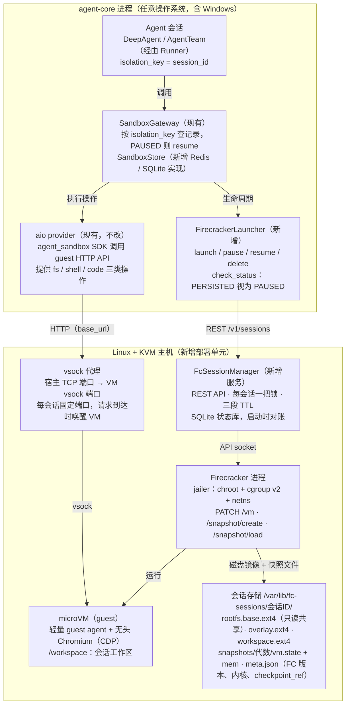
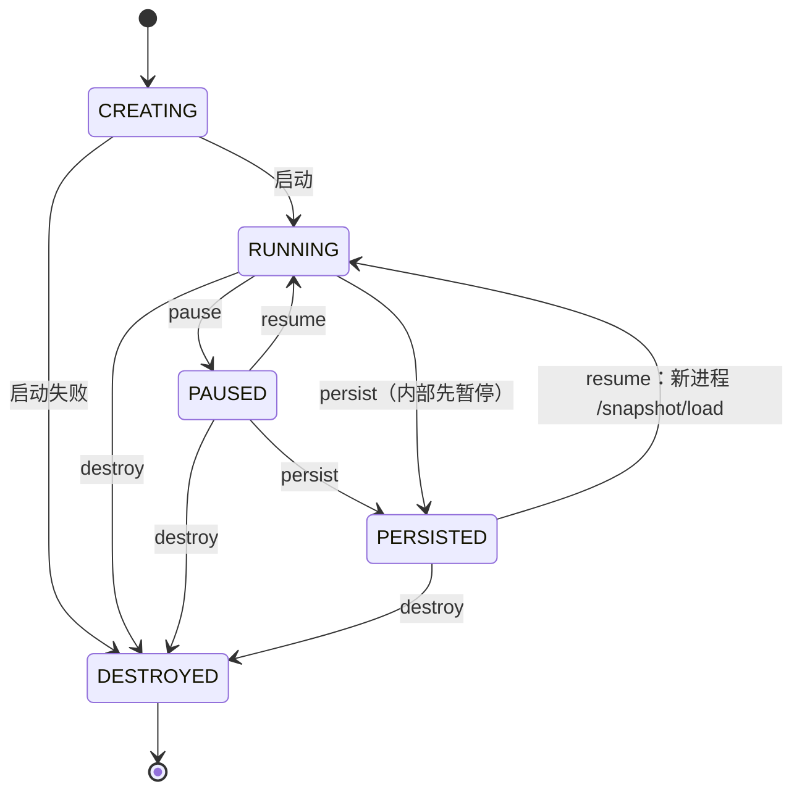

# Firecracker 会话管理器设计提案

英文版：[assets/design_en.md](assets/design_en.md)

## 背景与目标

建议新增一个 `firecracker` sandbox launcher，并配一个运行在 Linux/KVM 主机上的 FcSessionManager 服务。这样每个 DeepAgent 或 AgentTeam 会话都会独占一台 microVM，并且可以创建、暂停、持久化、恢复和销毁。

目前 agent-core 的 sandbox 依赖外部预部署服务（`pre_deploy` + aio / jiuwenbox / yuanrong）。会话结束后，执行环境的状态（文件、进程、已安装依赖）由外部系统决定，agent-core 无法保证它能跟 checkpointer 中的会话状态一起恢复。

**目标**

1. 隔离：每个会话一个 microVM，使用 KVM 硬件隔离，比容器更强。
2. 生命周期：create / pause / persist / resume / destroy 五个操作都可以由 agent-core 驱动。
3. 可恢复：会话持久化后，可以在进程重启甚至跨天之后原样恢复，包括内存中的进程。
4. 低侵入：复用现有的 `SandboxLauncher`、`SandboxGateway` 和 provider 抽象，DeepAgent / AgentTeam 业务代码不需要修改。

**非目标**：多主机调度、跨主机迁移快照、GPU 直通。这些放到后续阶段。

## 现状分析（agent-core `staging` 分支）

生命周期的接口已经有了，缺的是一个真正管理 VM 的 launcher、一个持久化的 store，以及会话释放时的回收链路。

| 组件 | 位置 | 现状 | 对本方案的意义 |
| --- | --- | --- | --- |
| `SandboxLauncher` | `core/sys_operation/sandbox/launchers/base.py` | 已定义 `launch / pause / resume / delete / check_status` | 直接实现一个 `FirecrackerLauncher` |
| `SandboxRegistry` | `core/sys_operation/sandbox/sandbox_registry.py` | 用装饰器注册 launcher 和 provider | 注册 `launcher_type="firecracker"` |
| `SandboxGateway` | `core/sys_operation/sandbox/gateway/gateway.py` | 按 `isolation_key` 查记录：PAUSED 则 resume，缺失则 launch；支持 `on_stop` 和 `idle_ttl_seconds` | 已经是会话级的路由层，只缺「持久化」这个状态 |
| `InMemorySandboxStore` | `gateway/sandbox_store.py` | 只有内存实现；`GatewayStoreConfig.redis_url` 已预留但未实现 | 进程重启后记录会丢，必须补一个持久化 store |
| `ContainerScope` | `core/sys_operation/config.py` | `SYSTEM / SESSION / CUSTOM`，默认 SESSION，`{session_id}` 模板在调用时解析 | 一个会话对应一台 VM 的映射已就绪 |
| aio provider | `extensions/sys_operation/sandbox/providers/aio.py` | 通过 `agent_sandbox` SDK 调用 HTTP API 做 fs / shell / code | Guest 内跑 AIO 兼容服务，就能零修改复用 provider |
| `Runner.release(session_id)` | `core/runner/runner.py:484` | 清理 checkpointer 和 team 表，**没有调用** `SandboxGateway.release_sandbox` | 会话释放时 VM 不会被回收，需要接上 |
| `NativeHarness.dispose` | `agent_teams/harness/native_harness.py:593` | 只从 `resource_mgr` 移除 sys_operation | 同上，team 成员销毁时不释放 sandbox |
| Checkpointer | `core/session/checkpointer/` | 按 `session_id` 保存 agent / workflow 状态（内存、persistence、redis） | VM 快照要和 checkpoint 配对，保证两边一致 |

## Firecracker 能力与约束

五个生命周期操作都能映射到 Firecracker 的原生 API。这里依据的是本地仓库 `D:\git_projects\firecracker`（上游 [firecracker-microvm/firecracker](https://github.com/firecracker-microvm/firecracker)，commit `4e65d4309`）中的 `docs/snapshotting/snapshot-support.md`、`docs/jailer.md` 和 `docs/vsock.md`。

| 会话操作 | Firecracker API | 说明 |
| --- | --- | --- |
| create | `PUT /boot-source`、`/drives`、`/network-interfaces`、`/vsock`、`/actions InstanceStart` | 通过 jailer 启动：独立 uid/gid、chroot、cgroup v2、netns |
| pause | `PATCH /vm {"state":"Paused"}` | vCPU 和设备仿真停止，内存仍常驻，恢复最快 |
| persist | pause → `PUT /snapshot/create {"snapshot_type":"Full"}` → 结束进程 | 生成 vmstate 文件和内存文件；磁盘文件由我们自己管理并已 fsync |
| resume | 从 PAUSED：`PATCH /vm {"state":"Resumed"}`；从 PERSISTED：新进程 `PUT /snapshot/load {"resume_vm":true}` | load 时用 MAP_PRIVATE 按需加载内存；可用 `network_overrides`、`vsock_override` 重新绑定主机资源 |
| destroy | `SendCtrlAltDel` 或直接 kill + 清理 chroot、TAP、磁盘和快照 | 幂等操作 |

**必须遵守的约束**

- 主机必须是 Linux + KVM。Windows 开发机不能直接运行，所以 FcSessionManager 要作为独立服务部署在 Linux 主机上，agent-core 通过 HTTP 调用它。
- 快照只能在软硬件配置相同的主机上恢复，快照文件格式也和 Firecracker 版本绑定。快照元数据里要记录 Firecracker 版本、主机内核和 CPU 模板。
- 恢复后所有已有的 vsock 连接都会关闭（listen socket 保留），TCP 连接也不保证存活。主机与 guest 的通信必须是短连接并支持重连。
- 同一个快照恢复多次是不安全的：随机数种子、熵池和 token 会重复。一个会话快照只恢复一次；若要做预热池克隆，必须依赖 VMGenID 并在 guest 内重新播种。
- Diff 快照仍处于 developer preview，第一至第三阶段只用 Full 快照，第四阶段再引入 Diff 快照。
- MMDS 的数据以及 logger / metrics 配置不会随快照保存，恢复后要重新下发。

## 架构



agent-core 只负责路由和生命周期调用；VM、快照和磁盘都由 Linux 主机上的 FcSessionManager 管理。fs / shell / code 操作不经过 FcSessionManager，而是由 aio provider 通过 vsock 代理直达 guest。

**网络边界**：前端只访问 agent-core，只有 agent-core 能经 vsock 代理访问 guest，guest 不对外暴露任何入站端口。agent-core 的公网出口仅放行 LLM 接口（出口白名单）。Guest 可以访问公网（`pip install`、`git clone` 等）：每台 VM 的 TAP 网卡位于各自的 jailer netns，经主机 NAT 出网；出站只允许公网地址，禁止访问主机、内网网段和云厂商元数据地址。MMDS 请求由 Firecracker 在设备层拦截，不会到达 TAP，因此不受这些规则影响。

**部署方式**：FcSessionManager、vsock 代理和 Firecracker 进程都运行在一个基于 Ubuntu 的 Docker 容器中。要求如下：

- 运行 Docker 的机器本身必须是带 KVM 的 Linux（裸金属，或开启嵌套虚拟化的云主机）。容器不提供 KVM；Windows / macOS 上的 Docker Desktop 通常拿不到 `/dev/kvm`，所以开发机只运行 agent-core。
- 容器以 `--privileged` 运行并挂入 `/dev/kvm`：jailer 要创建 cgroup、网络命名空间、TAP 设备和 NAT 规则。Firecracker 自己的 `tools/devtool` 也是这样运行测试容器的。
- `/var/lib/fc-sessions` 和 SQLite 状态库必须挂在宿主机 volume 上。VM 是容器内的子进程，容器重启会杀掉所有 RUNNING / PAUSED 的 VM；只有 PERSISTED 的会话能撑过重启，对账时把其余会话标为异常。

## 会话生命周期



各状态占用的资源：RUNNING 占用 vCPU + 内存；PAUSED 时 vCPU 停止、内存常驻；PERSISTED 时进程退出、只占磁盘；DESTROYED 时 VM 进程、磁盘、快照和 TAP 全部删除。

PAUSED 恢复只需要重新调度 vCPU；PERSISTED 恢复要启动新进程并加载快照，内存按需缺页载入。RUNNING 也可以直接 persist，管理器内部会先暂停再拍快照。

| 转换 | 触发方 | Firecracker 调用与主机动作 |
| --- | --- | --- |
| → CREATING → RUNNING | Gateway 首次解析 `isolation_key` | 创建 overlay 和 workspace 磁盘 → jailer 启动 → 配置设备 → `InstanceStart` → 等待 guest 服务就绪 |
| RUNNING → PAUSED | `on_stop="pause"` 且 `pause_mode="memory"`；或空闲超过 T1 | `PATCH /vm Paused` |
| PAUSED → RUNNING | 下一次工具调用（Gateway 发现 PAUSED） | `PATCH /vm Resumed` |
| RUNNING / PAUSED → PERSISTED | `pause_mode="snapshot"`；或暂停超过 T2；或主机内存水位过高 | flush checkpoint → `PATCH /vm Paused` → `PUT /snapshot/create Full` → 写 meta.json → 结束进程，删除 TAP |
| PERSISTED → RUNNING | 下一次工具调用（经 `launch()` 或代理唤醒）或显式 `:resume` | 校验版本和 `checkpoint_ref` → 新 jailer → `PUT /snapshot/load {resume_vm:true}` 并带 `network_overrides` / `vsock_override` → 重新下发 MMDS、logger 配置 |
| 任意 → DESTROYED | `Runner.release`、team dispose、`on_stop="delete"`、持久化超过 T3、启动失败 | kill 进程 → 删除 chroot、TAP、磁盘、快照和记录 |

### 默认策略

| 设置 | 默认值 | 理由 |
| --- | --- | --- |
| `on_stop`（运行结束时） | `keep` | agent-core 不在运行结束时暂停 VM，由 FcSessionManager 统一掌握时机；用户很快追问时 VM 仍在运行，后台任务也继续执行 |
| `pause_mode`（调用方显式暂停时） | `memory` | 从内存恢复只需毫秒级 |
| T1：RUNNING → PAUSED | 10 分钟内没有工具调用经过代理 | 运行中工具调用间隔为几秒到几分钟，实际上不会暂停正在进行的运行。暂停会冻结后台任务（dev server、构建、pip install），恢复后继续，但暂停期间没有进展 |
| T2：PAUSED → PERSISTED | 30 分钟；主机内存压力大时提前，优先持久化最久未用的会话 | 暂停的 VM 仍占满内存：每台 2 GiB 时，64 GiB 主机约可容纳 25–30 台 |
| T3：PERSISTED → DESTROYED | 7 天，且不短于 checkpointer 的保留期 | 若 VM 先于 checkpoint 被删，agent 会记得已不存在的文件 |
| Gateway `idle_ttl_seconds` | 不设置 | 到期一律删除；三段 TTL 统一由 FcSessionManager 管理 |

以上均为 profile 级配置。若第二阶段测得 2 GiB guest 从快照恢复不到约 1 秒，可把 T2 缩短到 10 分钟左右。

## API 设计与集成点

对外分两层：FcSessionManager 提供 REST API，agent-core 侧的 `FirecrackerLauncher` 只是它的薄客户端。

### FcSessionManager REST API

| 方法 | 路径 | 作用 | 幂等 |
| --- | --- | --- | --- |
| POST | `/v1/sessions` | 创建会话，参数为 `session_id` 和 `profile`（vCPU、内存、镜像、磁盘大小、网络策略）；如果已存在且处于 PERSISTED，则自动恢复 | 是 |
| GET | `/v1/sessions/{id}` | 返回 `state`、`base_url`、`snapshot_gen`、`last_used_ts` | 是 |
| POST | `/v1/sessions/{id}:pause` | RUNNING → PAUSED | 是 |
| POST | `/v1/sessions/{id}:persist` | RUNNING/PAUSED → PERSISTED；可传 `checkpoint_ref` 记录对应的 checkpoint | 是 |
| POST | `/v1/sessions/{id}:resume` | PAUSED/PERSISTED → RUNNING | 是 |
| POST | `/v1/sessions/{id}:fork` | 从该会话最新快照加载 N 台相互独立的 VM，返回 N 个新 session_id（第四阶段） | 否 |
| DELETE | `/v1/sessions/{id}` | 销毁 VM，并删除磁盘和快照 | 是 |
| GET | `/v1/sessions?state=` | 列出会话，用于对账和运维 | 是 |

同一个会话的所有变更都按 `session_id` 加锁串行执行。状态先写入 SQLite，然后再操作 VM。服务启动时按记录对账，把进程已不存在的 RUNNING 记录标为异常。

vsock 代理为每个会话分配固定端口，`base_url` 在会话整个生命周期内不变。请求到达时若 VM 处于 PAUSED 或 PERSISTED，代理先让 FcSessionManager 恢复 VM，再转发请求。因此 FcSessionManager 因空闲或内存压力自行暂停、持久化会话时，agent-core 无需感知。

### agent-core 侧改动

1. 新建 `openjiuwen/extensions/sys_operation/sandbox/launchers/firecracker.py`，用 `@SandboxRegistry.launcher("firecracker")` 注册 `FirecrackerLauncher`：
    - `launch()` 调用 `POST /v1/sessions`，返回 `LaunchedSandbox(base_url, sandbox_id=session_id)`。
    - `pause()` 按配置 `pause_mode` 调用 `:pause` 或 `:persist`。
    - `resume()` 调用 `:resume`；`delete()` 调用 `DELETE`。
    - `check_status()` 把 PAUSED 和 PERSISTED 都映射为 `SandboxStatus.PAUSED`，这样 Gateway 现有的「PAUSED 则 resume」逻辑无需改动。
2. 新增 `FirecrackerLauncherConfig(SandboxLauncherConfig)`，字段包括 `manager_url`、`profile`、`pause_mode: Literal["memory","snapshot"]`、`auth_token`；`sandbox_type` 默认为 `"aio"`。
3. 实现 `GatewayStoreConfig.type="redis"` 或 `"sqlite"`，使 `SandboxRecord` 在 agent-core 进程重启后仍可找到。
4. 在 `Runner.release(session_id)` 和 `NativeHarness.dispose()` 中调用 `SandboxGateway.release_sandbox(isolation_key, on_stop=...)`，使会话结束时 VM 被回收或持久化。
5. 一致性：persist 前先调用 `Session.flush_checkpoint()`，并把 checkpoint 标识作为 `checkpoint_ref` 写入快照元数据；resume 时校验两者是否匹配。
6. 连接错误兜底：provider 调用遇到连接错误时，Gateway 清除该会话的 provider 缓存和记录，重新解析 endpoint（走 `launch()`，由 `POST /v1/sessions` 恢复 VM），再重试一次。这覆盖了 FcSessionManager 自行 pause / persist、而 Gateway 记录仍为 RUNNING 的情况：现有代码会直接复用缓存的 provider 和 RUNNING 记录（`gateway.py` 第 125、203 行）。

### 使用示例

```python
gateway_config = SandboxGatewayConfig(
    isolation=SandboxIsolationConfig(container_scope=ContainerScope.SESSION),
    launcher_config=FirecrackerLauncherConfig(
        manager_url="http://fc-host:8700",
        profile={"vcpus": 2, "mem_mib": 2048, "image": "aio-ubuntu-24.04"},
        pause_mode="memory",
        on_stop="keep",
        idle_ttl_seconds=None,  # TTL 由 FcSessionManager 负责
    ),
)
```

Gateway 的 `idle_ttl_seconds` 到期时一律删除 VM，不论 `on_stop` 如何设置（`gateway.py` 第 282 行），删除后无法恢复。因此要么不设置，由 FcSessionManager 的三段 TTL 负责；要么设为不小于 T3。

### DeepAgent 与 AgentTeam 的映射

- DeepAgent：`isolation_key = {session_id}`，一个会话一台 VM。
- AgentTeam：整个 team 会话共用一台 VM，成员在 VM 内各自的 worktree 子目录工作，和现有 team_workspace / worktree 的共享模型一致。

## Guest 镜像与浏览器

所有 VM 都启动同一个精简 Ubuntu rootfs，内含我们自己的轻量 guest agent 和无头 Chromium。guest agent 只实现 aio provider 实际调用的 7 个 `agent_sandbox` 接口（`file.read_file`、`write_file`、`list_path`、`glob_files`、`upload_file`、`download_file`、`shell.exec_command`），因此 provider 无需修改；用契约测试让 provider 分别对接真实 AIO 容器和我们的 agent，比对结果。镜像预装 Python、Node、git 和 build-essential，其余依赖经 guest 的公网访问按需安装。

**浏览器**：每个会话在自己的 VM 内拥有独立的 Chromium。

1. guest agent 在首次使用时启动 Chromium 并开启远程调试（CDP）端口，下载目录设为 `/workspace/downloads`。
2. vsock 代理把该端口暴露为每个会话的第二个 endpoint。
3. agent-core 创建 browser subagent 时传入 `browser_instance = BrowserInstanceConfig(key=session_id, driver_mode="remote", cdp_url=<该 endpoint>)`。这个 key 让每个会话在 agent-core 主机上有自己的 Playwright MCP 服务；不设置的话，所有会话共用一个浏览器并排队执行（`service_registry.py` 中的 `task_turn`）。
4. 普通 pause 不会关闭浏览器连接，但暂停太久可能触发客户端超时。从快照恢复会关闭连接（vsock 重置），而 Chromium 的标签页和登录状态会随 VM 内存一起恢复；Playwright 一侧需要在恢复后重连。

Chromium 会增加内存占用，默认 VM profile 要为它留出余量；第一阶段测量 Chromium 空闲和工作时的内存。面向 computer-use 的完整桌面不在本次范围内，如有需要，可以之后把转换后的 AIO 镜像作为单独的 profile 加入。

## 多用户支持

每个用户有自己的会话，每个会话有自己的 VM，用户之间从不共用 VM。每个用户的设置（LLM 模型与密钥、工具、MCP 服务）都留在 agent-core：每次请求时，agent-core 加载调用方的配置，为该会话构建 agent。VM 只执行这个 agent 发来的工具调用，因此不需要知道这些设置。

| 关注点 | 设计 | 阶段 |
| --- | --- | --- |
| 会话归属 | `POST /v1/sessions` 携带 `owner_user_id` 并随会话保存；FcSessionManager 的每次调用都校验它，`GET /v1/sessions?owner=` 列出某个用户的会话。agent-core 的 API 层在路由前校验调用方拥有该 session_id。目前 sandbox key 只由 session_id 和固定前缀组成（`generate_isolation_key_template`，`core/sys_operation/sys_operation.py:22`），没有这道校验，任何持有 session_id 的人都能访问对应 VM | 1 |
| agent-core 内按用户命名 | `Runner.resource_mgr` 是进程全局的，工具和 MCP 的 ID 加用户（或会话）前缀，避免两个用户的同名 MCP 服务（如 `github`）冲突 | 3 |
| 用户自定义 MCP 服务 | 运行在该用户的 VM 内，而不是 agent-core 主机上；agent-core 经 vsock 代理以 streamable HTTP 连接，代理为每个会话的 MCP 服务开放额外端口。若在 agent-core 主机上以 stdio 方式运行，就等于在共享主机上执行用户的命令 | 3 |
| 工具所需的用户凭据 | VM 内工具需要的令牌（如 git push）按会话经 MMDS 下发，快照不会保存 MMDS 数据；不写入 VM 磁盘。LLM 密钥从不进入 VM | 3 |
| 按用户的资源档位 | 用户档位决定 VM profile：vCPU、内存、磁盘、限速和 TTL | 5 |
| 浏览器 | 每个会话在自己的 VM 内有独立的 Chromium；agent-core 设置 `browser_key = session_id`，会话之间不共用 Playwright MCP 服务、cookie 或任务队列 | 1 |

## 扩展能力

以下九项能力都已在本地仓库的 swagger（`src/firecracker/swagger/firecracker.yaml`）和文档中核实，分别纳入第一、二、四、五阶段。其中有三处与常见描述不同：`enable_diff_snapshots` 已废弃；seccomp 由 Firecracker 自身设置而非 jailer；`PATCH /drives` 只能替换已有 drive 的后端文件。

| 能力 | Firecracker API | 在会话管理器中的用途 | 注意事项 | 阶段 |
| --- | --- | --- | --- | --- |
| 从快照 fork | 多个新进程各自 `PUT /snapshot/load` 同一组 vm.state + mem，各自用 `network_overrides`、`vsock_override` 绑定自己的 TAP 和 vsock | 新增 `POST /v1/sessions/{id}:fork {count}`，返回 N 个新 session_id；用于并行探索、子 agent 分支 | 每个 fork 必须有独立的磁盘副本（reflink 拷贝 overlay 和 workspace）；每个 fork 放在独立 netns，快照里的 guest IP 可原样保留，出网靠主机 NAT 区分（`docs/snapshotting/network-for-clones.md`）；guest 内核需支持 VMGenID，恢复后重新播种并刷新 token；源内存文件要保留到所有 fork 结束（MAP_PRIVATE 依赖它） | 4 |
| Diff 快照 | `track_dirty_pages: true` 设在 `/machine-config` 或 `/snapshot/load`（每次 load 都要重设）；`PUT /snapshot/create {"snapshot_type":"Diff"}`。`enable_diff_snapshots` 已废弃 | persist 只写入上次快照后的脏页，缩短耗时、减少磁盘占用 | 仍是 developer preview；diff 一般要先用 `snapshot-editor edit-memory rebase` 按顺序合并到基础内存文件才能恢复；脏页跟踪有运行时开销 | 4 |
| 限速器 | `rate_limiter`（bandwidth 与 ops 两个 token bucket）：启动前在 `PUT /drives/{id}`、`PUT /network-interfaces/{id}`、`PUT /entropy` 设置；运行中用 `PATCH /drives/{id}`、`PATCH /network-interfaces/{id}` 调整 | profile 中加入按租户档位的磁盘和网络配额，防止 noisy neighbor | 只作用于设备仿真层，不能替代主机侧 cgroup 的 CPU 和内存限制 | 5 |
| 块设备热替换 | `PATCH /drives/{id}`（仅启动后）更新已有 drive 的 `path_on_host` 和 `rate_limiter` | 给运行中的会话换 workspace 盘：回滚到某个 checkpoint 的磁盘、挂载数据集盘 | 不能新增 drive，要在启动时预留空槽；替换期间 guest 不能挂载或读写该设备，所以 guest agent 要提供 unmount / mount 接口 | 4 |
| 内存气球 | `PUT /balloon`（启动前）、`PATCH /balloon` 调整目标大小、`GET /balloon/statistics`（需设 `stats_polling_interval_s`） | 回收空闲会话的内存以超卖；用内存压力统计决定何时 pause 或 persist，取代固定的 T1 | guest 内核需启用 virtio-balloon；回收过多会导致 guest OOM | 5 |
| 自定义 CPU 模板 | `PUT /cpu-config`（启动前）修改 CPUID 和 MSR 位；静态模板自 v1.5.0 起已废弃 | 所有主机用同一模板启动 VM，使快照能在不同代 CPU 的主机间恢复 | 必须在会话第一次启动时设好，否则已有快照无法移植；仍要求 Firecracker 版本兼容 | 2（默认模板）、5（跨主机） |
| MMDS | `PUT /mmds/config` 绑定网卡，`PUT` / `PATCH /mmds` 写入数据；推荐 V2（带 token） | 下发 session_id、guest agent 鉴权 token 和 profile，guest 无需访问外部网络 | 数据不随快照保存，每次 resume 或 fork 后都要重新写入；这也正好用来给每个 fork 下发新身份 | 1 |
| 熵设备 | `PUT /entropy`（virtio-rng，可带 `rate_limiter`） | guest 启动时就有足够熵，加快 TLS 和密钥生成 | guest 内核需 virtio-rng 驱动；不能代替 fork 后的 VMGenID 重播种 | 1 |
| Jailer | `jailer --id --exec-file --uid --gid --cgroup-version 2 --chroot-base-dir --netns` | 所有 VM 都经 jailer 启动：chroot、独立 uid/gid、cgroup v2、网络命名空间，作为基线隔离 | seccomp 不是 jailer 设置的：Firecracker 进程默认启用内置过滤器（`docs/seccomp.md`），FcSessionManager 禁止传 `--no-seccomp` | 1 |

## 风险

| 风险 | 影响 | 缓解 |
| --- | --- | --- |
| 快照占用磁盘：一个 Full 快照的内存文件等于 guest 内存大小 | 2 GiB 内存 × 1000 个持久化会话 ≈ 2 TiB | Diff 快照；稀疏文件 + zstd 压缩归档；`idle_ttl` 到期自动销毁；按主机设磁盘配额 |
| 恢复后连接中断 | 正在执行的 shell 流式输出会断开 | 只在会话空闲时 persist（Gateway 引用计数为 0）；provider 层对连接错误重试一次 |
| VM 快照与 checkpoint 不一致 | agent 记忆和文件系统状态错位 | persist 前先 flush checkpoint，用 `checkpoint_ref` 配对校验 |
| 快照重复恢复导致随机数重复 | 安全问题 | 会话快照恢复后即废弃旧代；预热池克隆需启用 VMGenID 并在 guest 重新播种 |
| 快照文件包含会话内存中的密钥 | 泄露风险 | 快照目录 0700 + 磁盘加密；离开主机前加密 |
| Firecracker 版本升级 | 旧快照无法加载 | 元数据记录版本；升级前恢复并重新持久化，或保留旧版本二进制 |
| Guest 可访问公网 | 外泄 workspace 内容、拉取恶意依赖、VM 被用来扫描或攻击他人 | guest 内不放任何密钥（LLM key 只在 agent-core）；出站屏蔽主机、内网和元数据地址；NIC 限速；记录出站连接；需要时按租户改为经出口代理的白名单 |

## 分阶段实施计划

分五个阶段交付。每个阶段都以可验证的验收标准结束，前一阶段未达标不进入下一阶段。

1. **第一阶段：单机 MVP**。内容：FcSessionManager 实现 create / pause / resume / destroy（暂不含 persist）；所有 VM 经 jailer 启动；会话归属（`owner_user_id`）由 FcSessionManager 和 agent-core 校验；配置熵设备；用 MMDS V2 下发 session_id 和 guest agent token；guest 经 TAP + 主机 NAT 访问公网，屏蔽主机、内网网段和云元数据地址；FcSessionManager 以 Ubuntu Docker 镜像交付；Guest 内运行我们自己的轻量 guest agent（兼容 AIO API）和无头 Chromium；browser agent 按会话经 `cdp_url` 和 `browser_key` 连接；agent-core 提供 `FirecrackerLauncher` 和 `FirecrackerLauncherConfig`。
    - 验收：`examples/` 中的 DeepAgent 通过 `launcher_type="firecracker"` 完成一次读写文件和执行 shell；VM 进程运行在 jailer chroot 内，guest 能从 MMDS 读到 session_id；guest 内 `pip install` 和 `git clone` 成功，访问主机地址和内网网段失败；其他用户携带该 session_id 的请求被拒绝；两个会话的 browser agent 可同时运行，cookie 互不相通；单测用 fake manager 覆盖 launcher 的所有方法。
2. **第二阶段：持久化与恢复**。内容：persist（Full 快照 + 磁盘拷贝）；从 PERSISTED 恢复并重新写入 MMDS；vsock 代理按会话固定端口并在请求到达时唤醒 VM；Gateway 遇连接错误时清缓存、重新解析并重试一次；所有 VM 使用统一的默认自定义 CPU 模板；SQLite 状态库与启动对账；agent-core 侧的持久化 `SandboxStore`；`checkpoint_ref` 配对。
    - 验收：guest 内一个后台进程在 persist → 重启 FcSessionManager → resume 后仍在运行，内存状态一致；FcSessionManager 因空闲自行 persist 后，同一 session_id 的下一次工具调用无需 agent-core 介入即可成功；关掉代理唤醒后，Gateway 兜底仍能让该调用成功；persist → resume 后 browser agent 能重连，且打开的页面仍在；记录 2 GiB guest 的 persist 和 resume 耗时。
3. **第三阶段：会话集成与 AgentTeam**。内容：在 `Runner.release` 和 `NativeHarness.dispose` 中接入 `release_sandbox`；三段 TTL 策略；team 成员共用一台 VM；工具和 MCP ID 按用户加前缀；用户自定义 MCP 服务运行在其 VM 内；工具凭据按会话经 MMDS 下发。
    - 验收：一个 3 成员 team 会话的整个生命周期内不泄露 VM（销毁后 `GET /v1/sessions` 为空）；系统测试覆盖 `stop_team` 和会话切换；两个用户各自注册同名 MCP 服务时互不冲突，且各自运行在自己的 VM 中。
4. **第四阶段：Fork 与增量快照**。内容：`:fork` API（reflink 磁盘副本、VMGenID 重播种、`network_overrides` / `vsock_override`、每个 fork 用 MMDS 下发新身份）；Diff 快照及 `snapshot-editor` 合并；用 `PATCH /drives` 热替换 workspace 盘实现磁盘回滚。
    - 验收：从同一快照 fork 3 个会话，各自写同一路径互不影响，`/dev/urandom` 输出和 token 各不相同；对比 Diff 与 Full persist 的耗时和文件大小并记录；热替换 workspace 盘后 guest 读到新内容且未重启。
5. **第五阶段：生产化**。内容：按用户档位决定 VM profile（规格、drive / NIC 限速、TTL）；内存气球与统计驱动的内存回收；跨代 CPU 模板；guest 出站连接审计日志、可选的按租户出口代理白名单、agent-core 出口白名单仅含 LLM 接口；快照压缩与加密；预热池；metrics 与告警。
    - 验收：使用预热池时 create 的 P95 耗时小于 1 秒；一个会话打满磁盘和网络时，其他会话的 I/O 延迟不超过设定阈值；气球回收不引发 guest OOM；安全评审通过。
